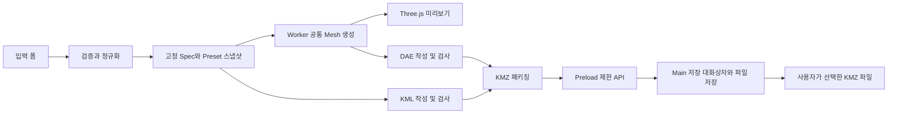

# 풍력발전기 KMZ 생성기 코드 구현 및 Windows EXE 배포 계획서

- 작성일: 2026-11-02
- 문서 버전: 1.0
- 기준 문서: [풍력발전기 KMZ 개발계획서 PRD SSD v1.0](./풍력발전기_KMZ_개발계획서_PRD_SSD_v1.0.docx)
- 대상 독자: 구현 개발자, 시험 담당자, 프로그램 배포 담당자
- 문서 상태: 구현 착수용 계획. 코드 구현·EXE 빌드·실제 배포는 아직 수행하지 않음.
- 최종 배포 방식: **다른 Windows PC에 전달하여 실행할 수 있는 `.exe` 프로그램**

> 2026-11-02 구현 착수 후의 실제 상태는 [README](./README.md)와 [검증 결과](./docs/검증결과.md)에 별도로 기록한다. 이 문서는 최초 계획 기준을 보존하며 아래의 미실행 표기는 계획 작성 시점의 상태다.

## 1. 목표와 현재 상태

사용자가 Windows 실행 파일을 받아 좌표, 허브 높이, 주풍향, 로터 직경을 입력하면 발전기 3D 미리보기를 확인하고 KMZ 파일을 원하는 폴더에 저장할 수 있도록 개발한다. 받는 사람에게 Node.js, Python, npm, 개발 서버 실행을 요구하지 않는다.

원문의 React·TypeScript·Three.js 기반 형상 생성 구조는 유지하고 Electron으로 Windows 데스크톱 프로그램을 구성한다. 모델 생성과 파일 저장은 해당 PC 내부에서 처리한다. Google Earth Pro는 생성 자체에는 필요 없으며, 생성된 KMZ를 지형 위에 열어 확인할 때 별도로 필요하다.

2026-11-02 폴더 확인 결과는 다음과 같다.

| 확인 항목 | 현재 상태 | 계획상 처리 |
|---|---|---|
| 개발계획서 | DOCX 1개 존재, 본문과 내장 외관 이미지 확인 | P01~P12, T01~T16을 구현·검증 기준으로 사용 |
| 기존 소스·README·패키지·테스트 | 없음 | 프로젝트 초기 구성부터 시작 |
| 프로젝트 AGENTS.md | 해당 폴더에는 없음 | 상위 작업공간 AGENTS.md와 사용자 지침 적용 |
| Git 저장소 | 현재 폴더는 Git 저장소가 아님 | 구현 착수 시 프로젝트 단위로 초기화할 계획 |
| 별도 참고 이미지 | 독립 PNG는 없음, DOCX에 `word/media/image1.png` 포함 | 내장 이미지를 외관 기준으로 사용하고 치수 근거와 구분 |
| 배포 계정·인증서·배포 URL | 이번 작업에서 확인하지 않음 | EXE 제작과 분리하여 출시 준비에서 결정 |

원본 식별용 SHA-256:

```text
70FED3F9A51BF082B5AEB62A0C38EECDF19FF95F7A9D07EB61B1F7DA17FC66AB
```

## 2. 원문 요구사항과 EXE 요구의 반영

### 2.1 최초 버전 범위

1. ENERCON E-175 계열의 개략 외관을 반영한 단일 발전기 생성.
2. WGS84 위도·경도, 허브 높이, 주풍향, 로터 직경 입력과 검증.
3. 발전기 이름, 설치고 보정, 정지 로터 자세, 고급 고도 설정 제공.
4. 타워·원판형 하우징·허브·3개 블레이드·돌출 후방 나셀 생성.
5. 확대·회전 가능한 3D 미리보기와 치수·방향·정확도 등급 표시.
6. 같은 입력 스냅샷과 형상으로 KML·DAE를 생성하고 KMZ로 저장.
7. Windows 설치형 EXE와 무설치형 EXE 제공.
8. 개발 도구가 없는 다른 Windows PC에서 실행·저장·Google Earth 확인.

CSV 일괄 입력, 지도 좌표 선택, 실시간 로터 애니메이션, 제조사 다종 확장, 계정·서버 DB·클라우드 동기화, 자동 업데이트는 후속 범위로 둔다. 최초 버전에는 로컬 분석 DB가 필요하지 않으므로 DuckDB·Polars도 도입하지 않는다.

### 2.2 원문에서 구체화하거나 변경하는 부분

| 원문 | 이번 계획에서의 반영 |
|---|---|
| P08 브라우저 KMZ 다운로드 | Windows 저장 대화상자로 `.kmz`를 저장하고 저장 성공·취소·실패를 구분 |
| P12 브라우저 내부 처리 | **P12-D: Electron의 로컬 렌더러에서 생성하고, main 프로세스에서 로컬 파일 저장. 좌표·모델 외부 전송 없음** |
| Chrome·Edge 성능 시험 | 배포된 EXE의 내장 Chromium에서 동일 목표로 시험. 브라우저 시험은 보조 회귀 확인 |
| 실행 가능한 프로그램 전달 | 설치형과 무설치형 EXE, 사용 안내, 체크섬, 버전별 시험 증빙 전달 |
| 8~12 작업일 | 원문 기능 개발 추정을 유지하고 EXE 패키징·실기 검증에 3~5일 추가, 총 11~17 작업일 추정 |

이 변경은 사용자 요청을 반영한 계획이다. 원본 DOCX를 수정하거나 P12의 원래 표현이 그대로 충족된 것으로 기록하지 않는다. 원문 추적표에 P12-D와 데스크톱 추가 시험 D01~D10을 연결한다.

## 3. 실행 파일과 기술 구성

### 3.1 배포 산출물

| 파일 예시 | 사용 방법 | 우선순위 |
|---|---|---|
| `WTG-KMZ-Generator-Setup-1.0.0-x64.exe` | 실행 → 사용자 계정에 설치 → 바로가기 실행 | 일반 사용자용 기본 배포 |
| `WTG-KMZ-Generator-Portable-1.0.0-x64.exe` | 파일 실행 → 프로그램 창에서 생성·저장 | 설치 없이 전달하는 배포 |
| `사용안내.pdf` 또는 `사용안내.md` | 입력 단위, 생성·저장, Google Earth 확인, 알려진 제약 안내 | EXE와 함께 제공 |
| `SHA256SUMS.txt`, `RELEASE_NOTES.md` | 전달 파일의 무결성·버전·제약 확인 | EXE와 함께 제공 |

설치형도 인터넷에서 본체를 추가로 받는 웹 설치기가 아닌 전체 설치 파일로 만든다. 무설치형은 런타임을 내장한 단일 배포 EXE를 목표로 한다. 실행 과정에서 임시 폴더에 런타임이 풀릴 수 있으며, 앱 설정과 OS 임시 파일까지 전혀 남지 않는다는 의미는 아니다. `win-unpacked` 폴더 안의 실행 파일 하나만 떼어서 전달하지 않는다. electron-builder의 Windows 대상에 `nsis`와 `portable`이 정의되어 있다. [R4]

### 3.2 기술 선택

| 영역 | 선택안 | 선택 이유 |
|---|---|---|
| 데스크톱 런타임 | Electron | Chromium·Node 런타임을 함께 배포하고 로컬 창·저장 대화상자 제공 |
| UI | React + TypeScript | 원문 설계 유지, 입력·상태·타입 계약 구성 |
| 프리뷰 | Three.js | 공통 형상을 3D로 표시하고 카메라 조작 제공 |
| 형상 코어 | DOM·Electron에 의존하지 않는 TypeScript | 수치 시험과 향후 브라우저판 재사용 |
| COLLADA 출력 | 제한된 기능의 자체 DAE 1.4.1 작성기 | 삼각형·법선·기본 재질만 구현하고 호환 범위를 통제 |
| ZIP | fflate 우선 검토 | 브라우저 Worker에서 KMZ 생성. G1에서 유지보수·라이선스·동작 확인 후 확정 |
| 개발 빌드 | Vite + TypeScript 컴파일 | 렌더러와 main/preload 빌드를 분리 |
| Windows 패키징 | electron-builder | NSIS 설치형과 portable를 같은 버전에서 생성 |
| 검사 | Vitest, ESLint, TypeScript, Playwright | 순수 로직·화면·Electron 실행 회귀 검사 |

위 조합은 권장 설계이며 설치하거나 버전을 확정한 상태는 아니다. G1에서 호환되는 안정 버전을 선택하고 정확한 버전과 `package-lock.json`을 고정한다. Electron 공식 문서의 프로세스 분리 구조를 따른다. [R1]

Tauri도 대안이지만, 이 계획에서는 내장 Chromium으로 PC 간 표시 조건을 맞추고 외부 WebView 런타임 준비를 줄이는 데 우선순위를 둔다. Electron의 배포 파일 크기·메모리 사용량은 실측 후 공개한다. EXE 용량을 원문의 KMZ 5MB 목표와 혼동하지 않는다.

### 3.3 지원 환경과 전제

- 최초 정식 지원 목표: Windows 11 x64, 일반 사용자 권한, RAM 16GB 기준 시험.
- Windows 10·ARM64는 별도 검증 전 지원을 보장하지 않는다.
- Google Earth Pro는 사용자가 별도로 설치한다. 앱 설치 파일에 함께 넣지 않는다.
- 최초 실행부터 인터넷 연결 없이 프리뷰와 KMZ 저장이 가능해야 한다.
- 모델·폰트·도움말·프리셋을 앱에 포함하고 CDN·지도·원격 API를 필수로 사용하지 않는다.
- 사용자 PC에는 Node.js·Python·npm·개발용 브라우저 확장이 필요하지 않다.

## 4. 코드 구조와 프로세스 경계

### 4.1 제안 폴더 구조

```text
WTG_KMZ_generator/
├─ electron/
│  ├─ main.ts                 # 창, 로컬 자산 로딩, 앱 종료
│  ├─ preload.ts              # contextBridge의 제한된 API
│  ├─ ipc.ts                  # 요청·송신자·크기 검증
│  └─ saveKmz.ts              # 저장 대화상자, 임시 파일, 확정 저장
├─ src/
│  ├─ app/                   # 폼, 상태, revision, 화면
│  ├─ domain/                # TurbineSpec, 검증, 파생 계산
│  ├─ presets/               # 치수·출처·정확도 등급
│  ├─ geometry/              # 타워·하우징·나셀·허브·블레이드
│  ├─ preview/               # Three.js 장면·치수선·조작
│  ├─ exporters/             # DAE, KML, KMZ, 출력 검증
│  ├─ workers/               # 형상·내보내기 작업
│  └─ shared/                # IPC 타입, 버전, 공통 오류
├─ tests/{unit,integration,e2e}/
├─ fixtures/                 # 공개 가능한 합성 입력·기준 형상
├─ scripts/                  # 산출물 검사·릴리스 manifest
├─ docs/                     # 치수 출처표·사용 안내·시험 기록
├─ build/                    # 아이콘·패키징 자산
├─ dist/                     # 렌더러 빌드, 생성물
├─ dist-electron/            # main·preload 빌드, 생성물
├─ release/                  # EXE·체크섬, 생성물
├─ electron-builder.yml
├─ package.json
└─ package-lock.json
```

이번 작업에서는 계획서만 생성한다. 위 폴더와 소스 파일은 향후 구현 대상이다. 빌드 산출물·서명 자격증명·사용자 KMZ·실제 좌표 로그는 소스 저장소에 넣지 않는다.

### 4.2 데이터 흐름



렌더러와 Worker는 입력·형상·ZIP 처리를 맡고 파일 시스템 권한을 갖지 않는다. main 프로세스는 창과 저장 기능을 맡으며 형상 생성의 단일 계산 결과를 다시 임의로 계산하지 않는다. preload는 IPC 전체를 노출하지 않고 필요한 메서드만 제공한다. [R1][R2]

```ts
interface DesktopApi {
  saveKmz(request: {
    requestId: string;
    revision: number;
    suggestedName: string;
    bytes: Uint8Array;
  }): Promise<
    | { status: 'saved'; filePath: string }
    | { status: 'cancelled' }
    | { status: 'failed'; code: string; message: string }
  >;
  getAppVersion(): Promise<string>;
}
```

위 API는 설계 초안이다. 구현 시 IPC에서 전송 가능한 타입을 확인하고, renderer의 요청 타입을 신뢰하지 말고 main에서도 검증한다. 저장 경로는 main이 연 OS 대화상자의 결과로만 정한다. 임의 경로 쓰기나 임의 명령 실행 API는 만들지 않는다.

## 5. 입력 계약과 상태 관리

### 5.1 TurbineSpec

| 필드 | 규칙 |
|---|---|
| `schemaVersion` | 입력 계약 버전 문자열 |
| `modelPresetId`, `presetVersion` | 기종과 치수·형상 버전 고정 |
| `name` | 기본 `WTG-01`, trim 후 1~80자, XML 및 파일명 처리 분리 |
| `latitude`, `longitude` | 유한수, 각각 -90~90, -180~180, WGS84 십진도 |
| `hubHeightM` | 0보다 큰 유한수, 설치 기준면에서 최종 허브 중심까지 |
| `rotorDiameterM` | 기본 175, 0보다 큰 유한수, 프리셋과 다르면 사용자 변형 표시 |
| `windFromDeg` | 0~360, 360→0, 진북 기준 바람이 불어오는 방향 |
| `baseOffsetM` | 기본 0, 양수는 위쪽, 유한수 |
| `rotorAzimuthDeg` | 기본 0, 정면에서 기준 날개가 위, 증가 방향 시계방향. 입력 범위 0~360 제안 |
| `altitudeMode` | `relativeToGround` 기본, 고급 설정에서 `absolute` |
| `baseElevationM`, `verticalDatum` | absolute일 때 필수, 유한 표고와 수직 기준 설명 |

`absolute`와 `relativeToGround`는 TypeScript 판별 유니온으로 정의해 필요한 표고가 없는 상태를 차단한다. WGS84 위도·경도만으로 수직 기준이 확정되는 것으로 취급하지 않는다. 이름 길이는 Unicode 코드 포인트 기준으로 통일하는 안을 채택한다.

입력의 빈 문자열을 `Number('')`로 0 처리하지 않는다. NaN·Infinity·범위 밖 값은 필드 오류로 처리한다. 작은 허브 높이 때문에 날개가 기준면 아래로 내려가면 확인 경고를 띄우되 입력 치수를 자동 수정하지 않는다. 기하 생성이 수치적으로 불가능하거나 자원 한도를 넘으면 이유를 표시하고 생성을 차단한다. 자원 제한 수치는 G1 실측 후 별도 정책으로 기록한다.

### 5.2 변경 중 생성과 재현성

1. 입력이 변경될 때 `revision`을 증가시키고 이전 결과가 최신 입력과 다름을 표시한다.
2. 미리보기 작업마다 정규화된 Spec와 프리셋을 복사한다. 완료 시 요청 ID·revision이 최신일 때만 반영한다.
3. KMZ 생성 버튼을 누르면 그 시점 스냅샷을 고정하고 미리보기·내보내기에 같은 Mesh를 사용한다.
4. 생성 중 추가 변경은 새 초안으로 유지하되 기존 작업 결과로 최신 화면을 덮어쓰지 않는다.
5. 저장 직전에도 스냅샷 일치를 확인한다. 입력이 바뀌었다면 최신 결과를 다시 생성하게 한다.
6. 실패·취소 후 입력은 유지한다. 재시도할 수 있고 불완전한 파일은 성공으로 표시하지 않는다.

상태는 `idle → validating → generating → ready → saving → saved`를 기본으로 하고 `invalid`, `failed`, `cancelled`, `stale`을 구분한다. 중복 생성·중복 저장은 잠그며 Worker·GPU·이벤트·임시 파일을 종료 시 해제한다.

입력 식별값은 정규화 Spec·프리셋 내용·생성기 버전으로 계산한다. 실행 순번인 revision과 콘텐츠 식별값은 구분한다. T09에서는 같은 스냅샷의 의미 데이터를 비교하고 ZIP 시간·실행 시각 같은 비본질 값은 제외한다.

## 6. 형상 구현과 좌표 규칙

### 6.1 기종·치수 출처

프리셋 이름은 `ENERCON E-175 EP5 E2`를 잠정 사용한다. 공식 제품 페이지에서 E1/E2 표기와 175m 직경을 확인했지만, 원문에 남은 `E175 EP2`가 이 기종을 의미하는지와 E2 세부 치수는 G1에서 확정한다. [R5]

치수 출처표는 `parameter, value, unit, sourceUrl, sourceTitle, sourceRevision, retrievedAt, confidence, applicableModel, notes`를 가진다. `confidence`는 `official`, `drawing`, `estimated`로 구분한다. 동일 기종 공식 외형도 → 제조사 자료 → 치수 도면 → 사진 비례 추정 순서로 사용한다.

원본 내장 이미지에서 확인한 원판형 하우징, 전면 허브, 길게 돌출한 사각 후방 나셀, 환기구·패널·타워 연결 위치를 모델링 기준으로 삼는다. 사진만으로 실제 길이를 확정하지 않는다. 미확정 치수는 UI와 KMZ 속성에 **개략 외관·추정 치수 포함**으로 표시한다. 제조사 인증 모델로 표현하지 않는다.

### 6.2 형상 코어

`buildTurbineMesh(spec, preset)`은 부품 ID, 정점, 법선, 삼각형 인덱스, 재질, 허브 중심, 로터 축, 날개 기준점을 반환한다. 코어의 계산은 가능하면 Float64 정밀도로 수행하고 미리보기 GPU 버퍼 변환과 분리한다.

| 부품 | 구현 방법 | 검증 핵심 |
|---|---|---|
| 타워 | 상·하부 반경이 다른 수직 테이퍼, 닫힌 단면 | 밑면 중심 원점, 허브 높이와 연결부 정합 |
| 하우징 | 짧은 원형 몸체·외곽 링·분할선 | 정면 원형과 축 방향 두께 |
| 후방 나셀 | 패널을 가진 사각 몸체·하부 구조·후면 환기구 | 로터 전면 반대편 배치, 측면 실루엣 |
| 허브 | 둥근 덮개와 세 날개 뿌리 연결부 | 최종 허브 중심 높이 |
| 블레이드 | 단면별 폭·두께·비틀림 보간, 120° 복제 | 3엽, 끝단 궤적 직경, 유효 법선 |

H 변경은 상부 조립체 크기를 바꾸지 않고 높이를 바꾼다. D 변경은 로터 길이 계산에 반영하며 나셀·타워 전체를 균일 확대하지 않는다. 허브 반경과 블레이드 뿌리 위치를 포함한 **최종 날개 끝 회전 궤적**이 입력 D가 되도록 한다.

### 6.3 방향과 회전

- 코어 좌표계: X=동쪽, Y=북쪽, Z=위쪽, 단위 m.
- 원점: 타워 밑면 중심. 기본 로터 전면 +Y, 후방 나셀 -Y.
- 풍향 θ에서 전면 법선 목표: `(sin θ, cos θ, 0)`.
- Three.js 프리뷰: 카메라·조작기의 up을 명시적으로 Z로 설정. 일반적인 오른손 Z 회전에서는 `-θ`를 사용해 위 목표 벡터와 비교한다.
- DAE: 기종의 로터 자세·축 경사·코닝·부품 변환을 반영하되 **지리적 yaw는 넣지 않는다**.
- KML: `heading=windFromDeg`, `tilt=0`, `roll=0`. 풍향 회전은 여기서 한 번만 적용한다.

Google의 Model 방향 규칙과 프리뷰 엔진의 회전 부호 차이를 어댑터로 분리한다. 네 방위에서 법선·나셀·원점을 비교하고 Google Earth 화면으로도 확인한다. [R6]

축 경사와 코닝은 G1/G2에서 각도·부호·직경 정의를 검증한다. 확인되지 않은 수치를 기본값으로 숨겨 넣지 않는다. 자료가 없으면 각도 0의 단순 모드와 정확도 등급을 공개하며, 기종 모드는 자료 확보 후 활성화한다. 이 경우 원문 대비 제약을 인수 기록에 남긴다.

### 6.4 높이와 지상 여유

```text
R = rotorDiameterM / 2
단순 모드의 회전 중 최고 높이 = hubHeightM + R
단순 모드의 회전 중 최저 높이 = hubHeightM - R
relativeToGround: KML altitude = baseOffsetM
absolute:         KML altitude = baseElevationM + baseOffsetM
DAE 허브 중심 Z = hubHeightM
```

H120·D175의 반경은 87.5m, 기준면 대비 회전 최고 207.5m, 최저 32.5m다. `baseOffsetM=2`이면 지면 대비 각각 209.5m·34.5m, 허브 122m가 된다. absolute 표고 300m·보정 0이면 허브 표고는 420m다.

설치고는 KML에서만 더하고 DAE에 중복 반영하지 않는다. 정지 자세 모델의 실제 최상단, 회전 중 높이 극값, 기준면 대비 여유를 구분해 표시한다. 축 경사·코닝 모드에서는 독립 회전 계산과 표본 간격 수렴 시험으로 극값을 구한다. 주변 산지와 날개 충돌을 이 숫자만으로 판정하지 않는다. Google 고도 모드의 기준을 따른다. [R7]

## 7. KML·DAE·KMZ 구현과 로컬 저장

### 7.1 패키지 계약

```text
WTG-01_E175_D175_H120.kmz
├─ doc.kml
└─ models/
   └─ turbine.dae
```

KML은 하나만 최상위에 두고 모델 경로는 `models/turbine.dae`로 고정한다. 외부 텍스처·모델 참조를 사용하지 않는다. 상대경로로 패키지를 완결한다. [R8]

- KML 2.2, 위치 값은 longitude·latitude를 구분하여 기록한다.
- `Placemark`에 name·description·ExtendedData를 넣고 그 안에 Model을 둔다. 원문의 “Model과 ExtendedData에 기록”을 구현할 때 **ExtendedData를 Model 자식에 넣지 않는다**.
- 속성에 전체 Spec, schemaVersion, generatorVersion, presetVersion, revision, 입력 식별값, 정확도 등급, 표고 기준을 기록한다.
- DAE는 COLLADA 1.4.1, `<unit meter="1">`, `Z_UP`, 삼각형·법선·기본 색상 재질을 사용한다.
- 최종 정점에 부품 변환을 반영하고 법선은 적절한 normal matrix로 변환·정규화한다. 음수 스케일은 회피하고 사용 시 면 방향도 교정한다.
- KML Scale과 DAE 전체 스케일은 1로 유지한다.
- 초기 예산은 총 삼각형 15,000개 이하. Google 문서의 21,845개 상한을 넘는 모델은 내보내지 않는다. [R6]

### 7.2 출력 검증

1. Mesh의 유한 좌표·인덱스·퇴화 삼각형·법선·재질 참조를 검사한다.
2. DAE를 독립 파서로 재해석하여 치수·단위·축·삼각형 수를 검사한다.
3. KML을 XML 파싱하고 CI에서 고정된 KML XSD로 구조를 검사한다. XSD와 의존 스키마는 시험 자산으로 버전 관리하여 런타임 인터넷 조회를 없앤다.
4. ZIP을 다시 열어 파일 개수·내부 경로·누락 참조·압축 데이터 유효성을 검사한다.
5. 메타데이터와 입력 식별값을 확인한 뒤에만 저장 가능한 결과로 전환한다.

KML 특수문자는 XML serializer로 처리하고 사용자 문자열을 HTML로 해석하지 않는다. 파일명에서는 경로 구분자·제어문자·Windows 예약 이름·끝의 점과 공백을 정리한다. 입력 이름과 안전한 파일명은 별도로 보존한다.

### 7.3 Windows 저장 처리

main 프로세스에서 `dialog.showSaveDialog`를 호출해 `.kmz` 저장 위치를 선택하게 한다. [R3]

1. 요청 sender가 허용된 앱 프레임인지 검사한다.
2. IPC 구조·요청 ID·중복 요청·바이트 크기·파일 확장자를 검사한다. 크기 한도는 G1에서 설정하고 UI·main에서 일치시킨다.
3. 저장 취소면 `cancelled`를 반환하고 오류 알림을 만들지 않는다.
4. 선택 폴더에 충돌 없는 임시 파일을 쓰고 파일 핸들을 닫는다.
5. 기존 파일이 있으면 OS 대화상자의 덮어쓰기 확인을 거친다. 확정 저장 실패 시 기존 파일을 먼저 삭제하지 않고 임시 파일을 정리한다.
6. 디스크 부족·권한·파일 잠금·이동식 디스크 분리·네트워크 경로 실패를 구분하고 입력과 생성 결과를 유지한다.
7. 성공 후에만 저장 위치와 완료 상태를 표시한다.

기존 정상 파일 보존을 위한 파일 확정 방식은 Windows에서 실패 주입으로 검증한다. 모든 파일 시스템에서 원자성이 보장된다고 가정하지 않는다. 사용자가 저장한 KMZ는 앱 제거·업데이트·설정 초기화 시 삭제하지 않는다.

## 8. 데스크톱 보안과 개인정보 처리

Electron은 main과 renderer의 권한 차이를 명시하고 다음 설정으로 구현한다. [R2]

- `nodeIntegration: false`, `contextIsolation: true`, `sandbox: true`.
- preload는 `contextBridge`로 정해진 메서드만 공개한다. `ipcRenderer` 전체·파일 시스템·shell을 노출하지 않는다.
- 배포판은 패키지 안의 자산만 읽고 개발 서버·원격 페이지를 로드하지 않는다.
- 새 창·임의 navigation·외부 프로토콜 실행을 차단한다. 도움말 링크가 필요하면 고정 HTTPS 허용 목록만 시스템 브라우저로 연다.
- CSP를 설정하고 production 자산·Worker·저장 기능이 동작하는지 패키지에서 확인한다. CSP를 우회하기 위해 보안 기능을 끄지 않는다.
- 좌표·모델·오류 보고 자동 업로드, 원격 분석, 자동 업데이트를 최초 버전에 넣지 않는다.
- 기본 입력 보존은 현재 실행 세션에 한정한다. 종료 후 좌표를 자동 저장하지 않는다.
- 로컬 진단 로그에는 오류 코드·버전·시험용 작업 식별자만 기록하고 실제 좌표·입력 이름·개인 경로는 기본 제외한다.
- 자격증명은 승인된 CI 비밀 저장소나 서명 장치에서만 사용한다. `.env`·인증서·키·개인 경로를 EXE·ASAR·로그에 포함하지 않는다.

ASAR는 소스 배포를 정리하는 패키지이며 암호화나 비밀 보관 수단으로 취급하지 않는다. exe 실행은 오프라인이어도 되지만 개발 의존성 다운로드·코드 서명·파일 전달 단계에는 별도 네트워크가 필요할 수 있다.

## 9. 단계별 코드 구현 계획

| 단계 | 작업 | 주요 산출물 | 다음 단계 통과 조건 |
|---|---|---|---|
| G1 기술 검증 | Electron 최소 창, 비대칭 방향 표식 DAE·KMZ, native 저장, 설치·portable 시험 빌드, 기종 확인 | 잠금 파일, 좌표 규약, 기준 KMZ, EXE 초안, 치수 미확정 목록 | 실제 Google Earth에서 네 방위·1m 단위·고도 확인, 다른 PC에서 EXE 실행 가능성 확인 |
| G2 형상 코어 | 입력 계약·프리셋·부품 생성, H/D 독립 처리, 방향·고도 계산 | domain·geometry·presets, 출처표, T03~T05 결과 | 치수·방향 오차 내 통과, 추정값 명시 |
| G3 화면·파일 | 폼·미리보기·Worker·revision·DAE/KML/KMZ·IPC 저장·실패 복구 | 실행 가능한 앱, T01~T09·T13~T15, D03~D05 결과 | 같은 스냅샷 출력, 오류·취소 후 재시도 가능 |
| G4 통합 시험 | 외관·산지·다른 PC·성능·오프라인·저장 예외, 패키징 회귀 | T10~T12·T16, D01~D10, 결함·재시험 기록 | 출시 차단 결함 0, 지원 환경과 제약 확정 |
| G5 인수·배포 준비 | 버전 고정·서명·최종 빌드·체크섬·안내·대표 KMZ | EXE 2종, 사용 안내, 릴리스 묶음 | 최종 배포 파일로 실행·생성·Google Earth 수용 확인 |

초기 일정은 원문 8~12일에 데스크톱 작업 3~5일을 추가한 **총 11~17 작업일 추정**이다. Electron 프로세스·저장 연결에 1~2일, 패키징·깨끗한 PC 검증에 1~2일, 서명·배포 안내에 1일을 추가 배정한다. 단일 개발자 기준이며 공식 외형도·검토 회신·인증서 발급 대기는 별도다. G1 결과로 재산정하고 일정 때문에 Google Earth 검증을 생략하지 않는다.

## 10. 시험 계획과 요구사항 추적

### 10.1 원문 T01~T16 유지

아래 수치는 원문의 합격 목표이며 이번 문서 작성으로 통과한 것이 아니다.

| ID | 검증 항목 | 기준과 실행 방식 | 연결 요구 |
|---|---|---|---|
| T01 | 좌표 | 경계·빈 값·비수치·범위 밖 검사, 직렬화 오차 ≤0.000001°, 경도·위도 순서 | P01 P02 |
| T02 | 제원 | 유한 양수, 단위, 풍향 360→0, 이름·고급 필드 검사 | P01 P02 |
| T03 | 형상 치수 | H 오차 ≤0.01m, D 오차 ≤0.05m, 3엽·120° 간격 | P03 P04 |
| T04 | 독립 변경 | H120→150에서 로터·나셀 불변, D175→160에서 허브 높이 불변 | P04 |
| T05 | 방위 | 0·90·180·270° 전면 N/E/S/W, 오차 ≤0.1°, 나셀 반대, 원점 불변 | P05 |
| T06 | 동일 형상 | 프리뷰·파일 스냅샷 일치, 같은 좌표 변환 후 정점 오차 ≤0.001m, 도우미 제외 | P06 P09 |
| T07 | 높이 | 기본·+2m·absolute 300m 계산, 오차 ≤0.01m, 이중 보정 없음 | P07 |
| T08 | 파일 | ZIP·KML XSD·DAE 참조 검사, 단위·축·속성 일치, 누락 0 | P08 P10 |
| T09 | 재현성 | 같은 스냅샷 2회 의미 데이터 동일, 식별값·revision·버전 검사 | P09 P10 |
| T10 | 외관 | 정면·측면·사선에서 하우징·나셀·허브·3엽·타워 연결·표면 확인 | P03 P06 |
| T11 | 지형 | 평지·산지, 지형 ON·고도 과장 1배, 부유·매몰·+2m 보정 기록 | P07 |
| T12 | 전달 호환 | 다른 PC 또는 깨끗한 프로필의 Google Earth에서 단일 KMZ 열기 | P08 |
| T13 | 실패 복구 | 형상·ZIP 실패 주입, 입력 보존, 부분 저장 차단, 재시도 성공 | P11 |
| T14 | 동시 변경 | 생성 중 입력·연속 클릭·종료, 오래된 덮어쓰기 0, 자원 정리 | P11 |
| T15 | 입력·네트워크 | XML·스크립트·경로 문자열, 텍스트 표시, 좌표·모델 업로드 0 | P12-D |
| T16 | 성능 | Windows 11·16GB에서 배포 EXE 10회, 프리뷰 p95 ≤1초, KMZ 준비 p95 ≤5초, KMZ ≤5MB | P12-D |

프리뷰 조작은 중앙값 30fps 이상을 목표로 한다. CPU·GPU·앱·내장 Chromium·Google Earth 버전을 기록한다. 10회 p95는 nearest-rank 방식의 10번째 값이며 표본이 적다는 점을 기록한다. 앱 최초 기동, 프리뷰 생성, KMZ 준비, 대화상자 이후 디스크 저장 시간은 분리한다.

공식 치수가 있는 외관은 해당 공차를 적용하고 공차가 없으면 원문의 계획 오차 1%를 사용한다. 추정 치수는 사진 비교·근거·정확도 등급을 검토한다. 형상 코드를 그대로 호출해 기대값을 만드는 순환 시험을 피하고 독립 수식·파서·기준 fixture를 사용한다.

### 10.2 EXE 추가 시험

| ID | 시나리오 | 합격 기준 |
|---|---|---|
| D01 | 개발 도구 없는 Windows PC에서 설치형 실행 | Node.js·Python 없이 설치·기동·프리뷰·KMZ 저장 성공 |
| D02 | 무설치 EXE 한 개만 전달 후 오프라인 실행 | 추가 자산 다운로드 없이 실행·생성·저장, 일반 권한 동작 |
| D03 | 저장 취소·덮어쓰기·한글/공백 경로·긴 경로 | 취소와 오류 구분, 기존 파일 보호, 지원 경로에서 정상 저장, 제한은 명확한 안내 |
| D04 | 권한 없음·디스크 부족·파일 잠금·저장 중 종료 | 성공 오표시 없음, 기존 정상 파일 보존, 재시도 가능 |
| D05 | renderer에서 비정상 IPC·sender·큰 데이터 전송 | 임의 경로·명령 실행 불가, 허용되지 않은 요청 차단 |
| D06 | 네트워크 차단 후 최초 기동·생성 | 원격 코드·폰트·지도 없이 완료, 앱의 좌표·모델 전송 0 |
| D07 | 이전 버전에서 새 설치 파일 실행·제거·재설치 | 버전 갱신, 앱 실행, 사용자가 저장한 KMZ 보존 |
| D08 | 해시·서명·Windows 보호 기능 확인 | 전달 파일 해시 일치, 정식 서명본 게시자·타임스탬프 확인, 탐지·차단 결과 기록 |
| D09 | 100%·150%·200% DPI, 작은 화면, GPU 오류 | 입력·저장 버튼 접근 가능, WebGL 실패 안내, 충돌 없는 종료 |
| D10 | 같은 EXE에서 생성한 KMZ를 다른 PC에서 열기 | 외부 자산 없이 표시, EXE·프리셋·KMZ 버전 추적 가능 |

### 10.3 기록과 출시 판정

시험 기록은 `testId, executedAt, appVersion, sourceCommit, lockfileHash, presetVersion, os, runtimeVersion, googleEarthVersion, inputFixture, expected, actual, status, evidencePath, defectId, retest`를 포함한다. 상태는 `미실행/통과/실패/차단`으로 구분한다. 실제 좌표가 포함된 기록은 공개 릴리스에서 제외하거나 합성 사례로 대체한다.

T01~T15와 D01~D10의 적용 항목 통과, 좌표 오류·풍향 반전·치수 불일치·높이 중복·KMZ 로딩 실패·낡은 입력 저장·기존 파일 손상 결함 0건을 출시 기준으로 삼는다. T16 미달은 실측값·원인·지원 범위를 명시해 출시 판정에 반영한다. 자동 시험 통과, EXE 배포 성공, Google Earth 외관 수용은 각각 기록한다.

## 11. 빌드와 EXE 패키징 계획

### 11.1 개발·검사 명령 계약

아래 명령은 향후 `package.json`에 구현할 스크립트 규약이다. 현재 실행 가능한 명령 목록이 아니다.

```powershell
npm ci
npm run dev
npm run typecheck
npm run lint
npm run test:unit
npm run test:integration
npm run build
npm run test:e2e
npm run dist:win
npm run verify:release
```

- `dev`: 렌더러 개발 서버 준비 후 Electron 실행. 개발 서버는 개발 환경에만 사용.
- `build`: renderer를 `dist/`, main·preload를 `dist-electron/`에 출력.
- `test:e2e`: Electron 창 기동·입력·프리뷰·저장 API·오류·종료 시험. 저장 대화상자 실기 확인도 병행.
- `dist:win`: Windows x64에서 `electron-builder --win nsis portable --x64 --publish never` 실행.
- `verify:release`: EXE 2종·버전·누락 자산·불필요 파일·해시·릴리스 manifest 검사.

main 진입점과 preload의 모듈 형식을 G1에서 확정한다. renderer용 `base`와 로컬 자산 경로를 패키지 실행에 맞추고, 소스 경로·개발 서버가 없는 깨끗한 PC에서 Worker와 모든 자산이 로드되는지 확인한다. Vite는 렌더러 빌드 도구로 사용하며 preview 서버를 운영 배포로 사용하지 않는다. [R9]

### 11.2 electron-builder 설정 초안

```yaml
# 구현 시 선택한 electron-builder 버전의 스키마로 검증할 초안
appId: com.wtgkmz.generator
productName: WTG KMZ Generator
asar: true
directories:
  output: release
  buildResources: build
files:
  - dist/**/*
  - dist-electron/**/*
  - package.json
win:
  icon: build/icon.ico
  requestedExecutionLevel: asInvoker
  target:
    - target: nsis
      arch: [x64]
    - target: portable
      arch: [x64]
nsis:
  oneClick: false
  perMachine: false
  allowToChangeInstallationDirectory: true
  artifactName: WTG-KMZ-Generator-Setup-${version}-${arch}.${ext}
portable:
  artifactName: WTG-KMZ-Generator-Portable-${version}-${arch}.${ext}
```

`appId`는 제안값으로 최초 배포 전에 발행자 식별과 함께 확정하고 이후 유지한다. 패키지 `main` 경로·라이선스·저작권·버전·사용 안내를 추가한다. 허용 목록 외 원본 DOCX·시험 이미지·소스맵·테스트·개인 데이터가 포함되지 않는지 검사한다. 필수 런타임 자산과 오픈소스 라이선스는 누락하지 않는다.

무설치 실행 파일명과 설치 실행 파일명을 반드시 구분한다. 생성한 EXE는 개발용 실행 성공 여부와 별도로 시험하고, 패키징 도구 버전 변경 때 두 대상 모두 재검증한다.

## 12. 배포·업데이트·복구 절차

### 12.1 배포 채널

최초에는 버전별 파일 전달을 기본으로 한다. 소규모 전달은 사내 승인 공유 폴더나 파일 전송 수단을 사용하고, 반복 배포가 필요하면 GitHub Releases 또는 조직 파일 배포 채널을 선택한다. 실제 저장소 생성·파일 업로드·공개 설정 변경은 이번 문서 작업에 포함하지 않는다.

앱은 별도 웹 서버 운영비 없이 실행할 수 있다. 배포 채널 접근 권한은 프로그램 실행과 분리한다. 공개 채널에는 원본 사용자 좌표·실제 현장 KMZ·비공개 참고 자료를 올리지 않는다. 참고 이미지 재배포 권한은 EXE·공개 저장소에 포함하기 전에 확인한다.

### 12.2 배포 순서

1. 소스 커밋, 앱 버전, 프리셋 버전, 잠금 파일을 고정한다.
2. 깨끗한 Windows 빌드 환경에서 설치·타입·정적 검사·단위·통합·E2E를 수행한다.
3. 설치형·무설치형 EXE를 생성하고 정식 배포본에 코드 서명·타임스탬프를 적용한다.
4. **서명 이후의 최종 파일**로 SHA-256과 manifest를 생성한다. 이후 EXE를 변경하면 해시와 검증을 다시 수행한다.
5. 개발 도구 없는 다른 Windows PC에서 실제 전달 파일로 D01~D10을 확인한다.
6. 해당 EXE로 대표 KMZ를 생성하고 Google Earth의 T10~T12를 확인한다.
7. 시험 요약·미해결 제약·체크섬·사용 안내와 함께 버전별로 묶는다.
8. 선택한 배포 채널에 전달하고 수신자가 받은 파일 해시와 실제 실행·저장을 확인한다.

정식 배포 묶음 예시:

```text
WTG-KMZ-Generator-v1.0.0/
├─ WTG-KMZ-Generator-Setup-1.0.0-x64.exe
├─ WTG-KMZ-Generator-Portable-1.0.0-x64.exe
├─ 사용안내.md
├─ RELEASE_NOTES.md
├─ SHA256SUMS.txt
├─ release-manifest.json
└─ samples/
   ├─ synthetic-H120-D175.kmz
   └─ synthetic-H120-D175.spec.json
```

manifest에는 앱·프리셋 버전, 소스 커밋, 빌드 환경, 파일명·크기·SHA-256, 서명 상태, 시험 보고서 위치를 기록한다. 소스와 전체 시험 증빙은 별도 개발 인수 묶음으로 제공할 계획이며, 일반 사용자용 EXE 전달에 필수는 아니다.

### 12.3 코드 서명과 Windows 실행 경고

일반 사용자 대상 정식 배포는 Windows 코드 서명을 계획한다. 인증서 또는 서명 서비스의 비용·발급 자격·조직 정책은 **검증 필요**이며 현재 특정 상품이나 가격을 확정하지 않는다. 서명은 게시자와 파일 무결성 확인에 사용하고, 모든 PC의 SmartScreen·백신 경고가 사라진다고 보장하지 않는다. 최종 파일을 실제 전달 경로에서 내려받아 확인한다. [R10]

미서명 파일은 시험용 상태로 구분하고 알려진 배포자·해시·검증 결과를 함께 전달한다. 백신이나 Windows 보호 기능을 끄는 방식을 배포 절차로 만들지 않는다. 오탐·조직 차단은 공식 신고나 조직 소프트웨어 허용 절차로 처리한다.

### 12.4 업데이트와 복구

- 최초 버전은 수동 업데이트. 새 설치 파일 실행 또는 portable EXE 교체 방식으로 운영한다.
- 같은 앱 ID를 유지하고 설치·재설치·구버전 교체의 파일 보존을 시험한다.
- 설정 스키마가 생기면 변경 전에 백업하고, 구버전이 읽지 못하는 변경을 릴리스 노트에 적는다.
- 장애 릴리스는 배포 채널에서 명확히 철회 표시하고 마지막 정상 버전을 안내한다. 기존 사용자 파일을 삭제하거나 자동 변환하지 않는다.
- 복구 검증은 이전 정상 EXE를 실행해 합성 입력으로 KMZ를 다시 생성하고 Google Earth에서 열어 수행한다.
- 원본 문서·소스·잠금 파일·프리셋·서명 후 EXE·체크섬·시험 기록을 버전별로 백업한다. 사용자 KMZ 백업은 사용자가 지정한 파일 보관 정책을 따른다.

## 13. 착수 시 확정할 항목과 위험

| 항목 | 현재 판단 | 해소 시점·조치 |
|---|---|---|
| 기종 표기 EP2 / EP5 E2 | 원문상 미확정 | G1에서 사용자 의도·동일 세부 기종 확인 |
| E2 나셀·허브·타워 치수 | 공식 상세 치수 미확보 | G2 전 출처표, 미확보분은 추정 등급 공개 |
| 축 경사·코닝·직경 정의 | 확인 필요 | G1/G2 자료 검토, 단순 모드와 기종 모드 구분 |
| DAE·고도·방향 호환 | 수치 시험만으로 불충분 | G1 최소 모델을 실제 Google Earth에서 확인 |
| Electron·ZIP·빌드 도구 버전 | 아직 설치·고정하지 않음 | G1 안정 조합과 라이선스 확인, 잠금 파일 생성 |
| portable·설치 정책 | 조직별 실행 제한 가능 | 다른 PC 일반 계정에서 D01/D02/D08 |
| 서명 주체·서비스·비용 | 미확정, 검증 필요 | G5 이전 준비, 정식·시험 배포 상태 구분 |
| 사용자 PC 성능·GPU | 미실측 | G4 성능·DPI·WebGL 실패 시험 |
| 배포 채널·수신 권한 | 미선정 | G5에 전달 대상에 맞춰 확정 |

자료 확보가 늦으면 값을 임의 확정하지 않고 공개된 개략 외관으로 구현을 진행한다. 좌표·높이·풍향·파일 호환의 필수 검증은 자료 대기와 별도로 진행할 수 있다.

## 14. 완료 체크리스트와 이번 문서의 검증 상태

### 14.1 개발 완료 시 확인

- [ ] 일반 사용자가 `.exe`만 받아 앱을 실행할 수 있다.
- [ ] 설치형·무설치형 모두 Node.js·Python 설치 없이 동작한다.
- [ ] 오프라인 상태에서 입력·미리보기·KMZ 저장을 완료한다.
- [ ] P01~P11·P12-D에 시험 기록이 연결되어 있다.
- [ ] T01~T15·D01~D10의 적용 시험 통과와 출시 차단 결함 0건을 확인한다.
- [ ] T16 실측값과 EXE 용량·앱 메모리 사용량을 기록한다.
- [ ] 공식·추정 치수와 외관 정확도 등급이 UI·파일·출처표에 일치한다.
- [ ] 다른 PC의 Google Earth에서 정면·측면·사선·산지·파일 이동을 확인한다.
- [ ] 최종 서명 파일·해시·사용 안내·릴리스 노트·대표 KMZ를 전달한다.
- [ ] 수신자가 받은 파일로 실행·KMZ 저장을 재확인한다.

### 14.2 이번 계획서 작성에서 확인한 것

- 원본 DOCX의 본문·표 내용을 읽고 내장 외관 이미지를 확인했다.
- P01~P12·T01~T16과 EXE 추가 요구를 코드 구조·검증·배포 단계에 연결했다.
- 원본의 입력·치수·방위·고도·파일 구조·성능 목표를 보존하고 데스크톱 변경을 명시했다.
- Electron·Google KML·제조사·Vite 공식 자료를 조회했다. 링크와 적용 범위는 아래에 남겼다.
- Markdown의 엄격한 UTF-8 해석, 깨진 로컬 링크 없음, P01~P12·T01~T16·D01~D10 표기 존재, 코드 블록 짝을 확인했다. 원본 SHA-256이 작성 전후 동일함을 확인했다.

실제 앱 코드·자동 시험·EXE·서명·설치·Google Earth 수용·배포 수신 확인은 모두 **미실행**이다. 위 체크리스트는 구현 후 증빙으로 완료 여부를 판정한다.

## 15. 근거 자료

외부 자료 조회일: 2026-11-02. 문서는 향후 변경될 수 있으므로 G1에서 적용 버전·조회일을 다시 기록한다. 이 계획의 일정·기술 선택·폴더 구조·IPC 계약·배포 채널은 원문을 바탕으로 구체화한 설계 제안이다.

| ID | 문서·원문 URL | 사용 범위·확인 상태 |
|---|---|---|
| 원본 | [풍력발전기 KMZ 개발계획서 PRD SSD v1.0](./풍력발전기_KMZ_개발계획서_PRD_SSD_v1.0.docx) | 입력·형상·P/T ID·시험 오차·일정의 기준, 전체 본문 확인 |
| R1 | [Electron Process Model](https://www.electronjs.org/docs/latest/tutorial/process-model) | main·renderer·preload 역할 확인 |
| R2 | [Electron Security](https://www.electronjs.org/docs/latest/tutorial/security) | 격리·sandbox·IPC·원격 콘텐츠 제한 확인 |
| R3 | [Electron dialog](https://www.electronjs.org/docs/latest/api/dialog) | main 프로세스의 저장 대화상자 API 확인 |
| R4 | [electron-builder WindowsConfiguration 원본](https://github.com/electron-userland/electron-builder/blob/master/packages/app-builder-lib/src/options/winOptions.ts) | 원본 소스의 `nsis`·`portable` target 확인. 세부 YAML은 선택 버전에서 검증 필요 |
| R5 | [ENERCON E-175 EP5 E1 / E2](https://www.enercon.de/en/turbines/e-175-ep5) | 기종명·175m 직경 확인. E2 세부 형상 치수 확보를 대체하지 않음 |
| R6 | [Google KML Reference](https://developers.google.com/kml/documentation/kmlreference) | Model 방향·축·Scale·ExtendedData 위치·삼각형 제한 확인 |
| R7 | [Google Altitude Modes](https://developers.google.com/kml/documentation/altitudemode) | relativeToGround·absolute 기준 확인 |
| R8 | [Google KMZ Files](https://developers.google.com/kml/documentation/kmzarchives) | 주 KML·ZIP 구성·상대경로 확인 |
| R9 | [Vite Deploying a Static Site](https://vite.dev/guide/static-deploy.html) | dist 빌드와 preview의 로컬 점검 용도 확인 |
| R10 | [Electron Code Signing](https://www.electronjs.org/docs/latest/tutorial/code-signing) | 배포 시 코드 서명 고려. 가격·발급 자격·경고 제거를 보장하는 근거로 사용하지 않음 |
| R11 | [Three.js Object3D](https://threejs.org/docs/pages/Object3D.html) | up·변환 구조의 구현 참고, 적용 버전에서 회귀 검증 |

요구사항이 바뀌면 관련 P/D ID와 시험을 함께 갱신한다. 프리셋 변경은 presetVersion을 올리고 T03~T12의 관련 항목을 재시험한다. 좌표·방향·고도 변경은 T01·T05·T07·T11·T12, 저장·패키징 변경은 T08·T12·T13 및 D01~D10의 관련 항목을 재시험한다.
